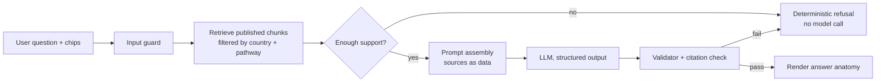

# API and AI strategy

Technical specification for Migration Hub's HTTP API and the RAG-based in-app assistant ("Ask"). Related: [architecture.md](architecture.md), [data-model.md](data-model.md), [requirements.md](requirements.md), [security.md](security.md).

> **Status:** specification only. No AI provider is installed. The assistant ships behind the `ai_assistant` feature flag and the Ask tab shows an honest "coming soon" state until it is enabled. AI never participates in eligibility screening, task dependencies or publishing (see section 3.8).

---

## Part A. API

### A.1 Style decision: REST, not GraphQL federation

The app is a single Next.js modular monolith with one database. Federation solves multi-team, multi-service schema composition, which this product does not have. Therefore:

- **REST over JSON** via Next.js Route Handlers (`src/app/api/v1/...`), plus **Server Actions** for first-party form mutations in Server Components.
- Route handlers are **thin**: authenticate, validate with Zod, call a service in `src/server/services`, map the result to the standard response. No business logic in handlers.
- Revisit GraphQL only if third-party clients or separate services emerge. An ADR is required to change this.

### A.2 Conventions

| Topic       | Rule                                                                                                                                                      |
| ----------- | --------------------------------------------------------------------------------------------------------------------------------------------------------- |
| Base path   | `/api/v1` (versioned in the path)                                                                                                                         |
| Format      | `application/json; charset=utf-8`, camelCase keys, ISO 8601 dates, money as `{ amountMinor, currency }`                                                   |
| IDs         | UUIDs. **User identity is never a parameter**: it is derived from the session                                                                             |
| Errors      | `{ "error": { "code", "message", "details?", "requestId" } }` using the `AppError` codes in `src/lib/errors`                                              |
| Validation  | Zod schema per endpoint, shared with the client form. Unknown keys are rejected (`.strict()`)                                                             |
| Idempotency | All non-idempotent `POST`s accept an `Idempotency-Key` header (stored 24 h). Retries are safe on flaky mobile networks                                    |
| Concurrency | Mutable resources return `version` (or `ETag`). Writes require `If-Match`, and a mismatch returns `409 conflict` with the server copy                     |
| Pagination  | Cursor-based: `?limit=&cursor=` returns `{ items, nextCursor }`                                                                                           |
| Caching     | Private data: `Cache-Control: private, no-store`. Published regulatory content: `s-maxage` plus `stale-while-revalidate` with tags revalidated on publish |
| Request IDs | `x-request-id` generated or propagated, and included in logs and error bodies                                                                             |
| Time limits | Handlers target under 2 s for p95 reads. Client timeout is 10 s with retry (requirements EC-10)                                                           |

Standard errors:

| HTTP | `code`             | Meaning                                                       |
| ---- | ------------------ | ------------------------------------------------------------- |
| 400  | `validation_error` | Zod failure, with per-field `details`                         |
| 401  | `unauthenticated`  | No or expired session                                         |
| 403  | `forbidden`        | Authenticated but not permitted                               |
| 404  | `not_found`        | Also returned for another user's resource (no existence leak) |
| 409  | `conflict`         | Version mismatch or duplicate                                 |
| 429  | `rate_limited`     | With `Retry-After`                                            |
| 503  | `not_configured`   | Required service or flag unavailable                          |

### A.3 Authentication and session security

- **Supabase Auth** with email and password and a magic link. Add Google sign-in only after a privacy review. Sessions use **httpOnly, Secure, SameSite=Lax cookies** managed by `@supabase/ssr`. No tokens in `localStorage`.
- A Next.js middleware (`proxy`) refreshes sessions and gates `(dashboard)` and `admin` routes. This is a convenience only: **every handler re-authenticates** with `supabase.auth.getUser()` (server-verified, not `getSession()`).
- **Authorization** in `server/policies`: ownership by session user ID, plus roles from `user_roles` for admin and reviewer routes. RLS is the second layer, so handlers use the per-request user client by default. The service-role client is only for audited admin or system operations.
- **CSRF:** cookie-authenticated mutations require an `Origin` check against `NEXT_PUBLIC_SITE_URL` plus `SameSite=Lax`, and JSON content type only.
- **Passwords and recovery:** follow WCAG 3.3.8 (paste and password managers allowed, no cognitive tests). Rate limit sign-in and reset endpoints per IP and per account.
- **Account deletion** removes the `auth.users` row, cascading user data (see data-model.md), and clears device caches via the client.

Endpoints under `/api/v1/auth` are thin wrappers or Server Actions around Supabase Auth.

| Method | Path                   | Purpose                                                              | Auth               |
| ------ | ---------------------- | -------------------------------------------------------------------- | ------------------ |
| POST   | `/auth/sign-up`        | Create account, sends verification email                             | none, rate limited |
| POST   | `/auth/sign-in`        | Password sign-in, sets cookies                                       | none, rate limited |
| POST   | `/auth/magic-link`     | Request a magic link                                                 | none, rate limited |
| POST   | `/auth/sign-out`       | Clear session                                                        | session            |
| POST   | `/auth/password-reset` | Request a reset email                                                | none, rate limited |
| GET    | `/auth/callback`       | OAuth/magic-link code exchange                                       | none               |
| DELETE | `/account`             | Delete account and all user data (requires recent re-authentication) | session            |

### A.4 Profile synchronization

Local-first: the client edits an offline copy, and the server is authoritative on conflict.

| Method                | Path                                  | Purpose                                                          |
| --------------------- | ------------------------------------- | ---------------------------------------------------------------- |
| GET                   | `/profile`                            | Current profile and `version`. Returns an empty skeleton if none |
| PATCH                 | `/profile`                            | Partial update of profile fields. Requires `If-Match: <version>` |
| PUT                   | `/profile/onboarding/steps/{step}`    | Save one onboarding step (1 to 6) and advance `onboardingStep`   |
| GET/POST/DELETE       | `/profile/destination-goals[/{id}]`   | Manage destination goals                                         |
| GET/POST/PATCH/DELETE | `/profile/clinical-experience[/{id}]` | Manage experience entries                                        |
| POST                  | `/sync`                               | Batch sync of queued offline mutations (see below)               |
| GET                   | `/profile/export`                     | Export all of the user's data (JSON)                             |

`PATCH /profile` request (all keys optional, `.strict()`):

```json
{
  "preferredName": "Ada",
  "residenceCountry": "NG",
  "medicalSchool": "University of Lagos",
  "graduationYear": 2019,
  "internshipStatus": "completed",
  "clinicalExperienceYears": 3.5,
  "specialty": "Paediatrics",
  "languageTestStatus": "booked",
  "timeline": "6_12_months"
}
```

`200` returns the profile with the new `version`. Fields explicitly sent as `null` are stored as unknown. A change to a screening-relevant field triggers an asynchronous re-screen and returns `screeningStale: true`.

**Batch sync, `POST /sync`:** the offline queue sends ordered operations, each with its own idempotency key and base version.

```json
{
  "operations": [
    {
      "opId": "uuid",
      "type": "plan_task.update",
      "targetId": "uuid",
      "baseVersion": 4,
      "patch": { "status": "completed" },
      "clientTime": "2026-10-15T20:00:00Z"
    },
    {
      "opId": "uuid",
      "type": "profile.patch",
      "baseVersion": 7,
      "patch": { "specialty": "Surgery" }
    }
  ]
}
```

Response gives per-operation results, `applied`, `duplicate` (idempotent replay), `conflict` (with `serverCopy`) or `rejected` (with error). The client shows `Synced`, `Waiting to sync` or `Needs attention` (requirements EC-3, EC-4). Conflicts on user-owned items are never silently overwritten. Regulatory content is never accepted from the client (the server rejects any such operation type).

Plan and content read endpoints (all `GET`, session required except published content):

| Path                                                                    | Purpose                                                                                            |
| ----------------------------------------------------------------------- | -------------------------------------------------------------------------------------------------- |
| `/destinations`, `/pathways`, `/pathways/{id}`                          | Published pathways with `contentStatus`, derived from verified and review-due dates                |
| `/pathways/{id}/requirements`                                           | Requirements from `current_requirements`, each with status, `verifiedDate`, `sourceUrl`, `version` |
| `/pathways/{id}/screening` (POST to run, GET latest)                    | Deterministic screening result with per-criterion results                                          |
| `/plans`, `/plans/{id}`, `/plans/{id}/tasks`                            | The user's plans and tasks                                                                         |
| `PATCH /plans/{id}/tasks/{taskId}`                                      | Update status, due date, notes (user-reported only)                                                |
| `/plans/{id}/proposals` and `POST .../{proposalId}/accept` or `decline` | Review proposed plan changes                                                                       |

### A.5 Autosave form endpoints

Two layers: **device autosave** (IndexedDB, immediate, always available) and **server drafts** (when online), so a draft survives a device change.

| Method | Path               | Purpose                                                           |
| ------ | ------------------ | ----------------------------------------------------------------- |
| GET    | `/drafts/{formId}` | Fetch the saved draft and its `version` (404 if none)             |
| PUT    | `/drafts/{formId}` | Upsert the draft. Body: `{ values, schemaVersion, baseVersion? }` |
| DELETE | `/drafts/{formId}` | Discard the draft                                                 |

Rules:

- `formId` is from an allow-list (`onboarding`, `profile-edit`, `task-notes:{taskId}`), and any other value gets `400`.
- The draft is validated **loosely** (Zod `.partial()` of the form schema) because drafts are incomplete by nature. Full validation applies only on submit.
- Last-write-wins per `formId` using `baseVersion`. On mismatch return `409` with the server draft, and the client offers "Use this device's draft" or "Use the other draft".
- The client debounces (about 800 ms) and sends at most one in-flight request per form, coalescing edits. Failures never block typing, and the local draft remains the source of truth until a successful sync.
- Size cap 32 KB per draft. Sensitive field names are rejected (no identity numbers, since none are collected).
- Drafts auto-expire after 90 days of inactivity and are cleared on successful submit and on account deletion.

```sql
create table form_drafts (
  user_id        uuid not null references auth.users(id) on delete cascade,
  form_id        text not null,
  values         jsonb not null,
  schema_version int  not null,
  version        int  not null default 1,
  updated_at     timestamptz not null default now(),
  primary key (user_id, form_id)
);
-- RLS: own rows only (select, insert, update, delete).
```

### A.6 Notification preferences

```sql
create type notification_channel as enum ('in_app', 'email');
create type notification_topic as enum
  ('task_due', 'requirement_changed', 'plan_proposal', 'content_being_checked', 'product_updates');

create table notification_preferences (
  user_id   uuid not null references auth.users(id) on delete cascade,
  topic     notification_topic not null,
  channel   notification_channel not null,
  enabled   boolean not null,
  primary key (user_id, topic, channel)
);

create table notification_settings (
  user_id         uuid primary key references auth.users(id) on delete cascade,
  timezone        text not null default 'UTC',
  quiet_hours     int4range,                        -- local hours, for example [22,7)
  digest          text not null default 'immediate' check (digest in ('immediate','daily','weekly')),
  version         int not null default 1,
  updated_at      timestamptz not null default now()
);
-- RLS: own rows only.
```

| Method | Path                         | Purpose                                      |
| ------ | ---------------------------- | -------------------------------------------- |
| GET    | `/notifications/preferences` | Preferences matrix and settings              |
| PUT    | `/notifications/preferences` | Replace the matrix and settings (`If-Match`) |
| GET    | `/notifications`             | In-app notifications (cursor paginated)      |
| POST   | `/notifications/{id}/read`   | Mark read                                    |
| POST   | `/notifications/read-all`    | Mark all read                                |

Defaults: in-app on for `requirement_changed`, `plan_proposal`, `task_due` and `content_being_checked`, with email opt-in (explicit consent recorded). Security-critical messages (verification, password reset) are transactional and not configurable. Notifications contain no sensitive profile detail, and email bodies link back into the app.

### A.7 Admin and content endpoints (summary)

Under `/api/v1/admin/...`, role-checked on the server (`reviewer` or `admin`), writing through the services described in data-model.md: create and edit draft requirement versions, submit for review, approve and publish (second reviewer), record re-verification, flag possible changes, and read audit events. Publishing triggers `revalidateTag` for affected pathways, and a change-detection job creates `requirement_changed` flags and plan change proposals for affected users. Admin routes never accept a `userId` to act as another user.

### A.8 Rate limits (initial targets)

| Scope                                            | Limit                                                     |
| ------------------------------------------------ | --------------------------------------------------------- |
| Sign-in, sign-up, reset (per IP and per account) | 5 per 15 min                                              |
| Profile, plan, draft writes (per user)           | 120 per min                                               |
| `/sync` (per user)                               | 20 per min, at most 100 operations per request            |
| `/ask` (per user)                                | 20 per hour and 100 per day (see Part B), tunable by flag |
| Public content reads (per IP)                    | 300 per min at the edge                                   |

Implemented in `src/lib/security` with a shared store, with `Retry-After` on `429`.

### A.9 Observability and privacy in the API

- Structured logs: request ID, route, status, latency, user ID hash. **Never log** request bodies of profile, draft or Ask endpoints, credentials or tokens.
- Metrics: error rate, latency, sync conflicts, draft save failures.
- OpenAPI document generated from the Zod schemas (for example `zod-openapi`) and checked into CI to prevent drift.

---

## Part B. RAG-based AI assistant (Ask)

### B.1 Purpose and non-goals

The assistant explains **published, verified regulatory content** in plain language and suggests next steps in the user's plan. It is a reading aid over the platform's own data, not an oracle.

Non-goals: determining eligibility, predicting outcomes or timelines, estimating fees beyond sourced figures, giving legal or immigration advice, browsing the open web, editing plans or content, or answering general medical questions.

### B.2 Context chips

Every Ask screen shows persistent **context chips** at the top: **Destination** (for example "United Kingdom") and **Pathway** (for example "GMC registration"). They are:

- **Always visible** and keyboard-operable (44 px targets), each opening a picker to change it. Changing a chip starts a new context (the conversation stays, but retrieval is re-scoped).
- **The retrieval filter:** `country` and `pathway_id` come from the chips, not from the model. The model can't widen scope.
- **Required to answer.** With no pathway chosen, the assistant answers only general platform questions ("how this app works") and prompts to choose a pathway. Primary button on Ask is "Ask a question", and with no context it is "Choose a pathway".
- Defaulted from the user's plan or destination goals, and shown as selected values the user can change, never hidden.

### B.3 Pipeline



1. **Input guard:** length cap (1,000 chars), strip control characters, reject obvious prompt-injection patterns, and detect refusal-category intents (fee, date, outcome questions) to flag for stricter evidence rules. Rate limit and feature-flag checks.
2. **Retrieval** over _published_ content only (section B.4).
3. **Support check:** deterministic. If no chunk meets the relevance threshold, **skip the model** and return the refusal answer.
4. **Generation** with a strictly structured output (B.5), low temperature, and a hard instruction hierarchy.
5. **Validation:** every claim must cite a provided chunk. All source-card fields come from the database, never from the model.
6. **Render** the four-part anatomy. If validation fails, retry once, then return a refusal.

The model is called from an isolated server module (`src/server/ai`) through a provider-agnostic interface, so the vendor is swappable and no other module imports a provider SDK.

### B.4 Knowledge base and retrieval

**Corpus (allow-list, nothing else):**

- `requirement_versions` with `status = 'published'`.
- Published `cost_estimates`.
- Published `task_templates` descriptions.
- Optionally the user's **own plan tasks** as _context_ (not as a source of regulatory facts), included only for that user, to tailor "next actions".

Never in the corpus: drafts, in-review versions, superseded versions (unless the user asks about history, in which case they're labelled), web pages, user profile free text, other users' data.

**Indexing:**

- One chunk per requirement version (split only if over about 500 tokens), with metadata: `requirement_id`, `version`, `country`, `regulator`, `pathway_id`, `obligation`, `source_url`, `verified_date`, `review_due_date`, `access_date`, `effective_date`.
- Stored in Postgres with **pgvector** (`content_embeddings` table, HNSW index) alongside full-text search. Embeddings are provider-agnostic and regenerated on publish by a background job. Superseding a version removes its chunks from the live index in the same transaction.
- **Hybrid retrieval:** vector similarity plus keyword rank, filtered by `country` and `pathway_id`, top 6 chunks, with a relevance threshold below which a chunk is discarded.
- Metadata used for display always comes from the database row at answer time (`current_requirements`), so a re-verified date or a "Being checked" flag is current even if the embedding is older.

**Content freshness handling:**

- Chunks whose requirement is **Being checked** (review overdue or flagged) may be retrieved, but the answer must label them "Being checked" with their last verified date and tell the user to check the source before acting.
- The assistant never states anything as current without a `verified_date`.

### B.5 Output anatomy (strict contract)

Every answer has exactly these four parts, in this order. The model returns JSON validated by Zod, and the UI renders it. Free-form output is not accepted.

```ts
const AskAnswerSchema = z
  .object({
    outcome: z.enum(["answered", "partial", "refused"]),
    // 1. Direct plain-language answer
    answer: z.string().max(1200), // plain language, no legal advice phrasing
    claims: z.array(
      z.object({
        text: z.string(),
        sourceChunkIds: z.array(z.string()).min(1), // every claim cites at least one provided chunk
      }),
    ),
    // 3. Uncertainty / missing info
    uncertainty: z.array(
      z.object({
        kind: z.enum([
          "missing_profile_info",
          "source_gap",
          "being_checked",
          "varies_by_circumstance",
          "out_of_scope",
        ]),
        text: z.string(),
      }),
    ),
    // 4. Suggested next actions (bounded, from an allow-list of action types)
    nextActions: z
      .array(
        z.object({
          type: z.enum([
            "open_source",
            "open_requirement",
            "add_profile_field",
            "add_to_plan",
            "open_task",
            "contact_regulator",
          ]),
          label: z.string(),
          targetId: z.string().optional(),
        }),
      )
      .max(3),
  })
  .strict();
```

**Source cards (part 2)** are built by the server, not the model, from the cited chunks:

| Field          | Source                                                    |
| -------------- | --------------------------------------------------------- |
| Publisher      | `regulators.name`                                         |
| Title          | Requirement title                                         |
| Verified date  | `verified_date` (current via `current_requirements`)      |
| Status chip    | Verified or Being checked, derived                        |
| Link           | `source_url` ("Open official source", opens in a new tab) |
| Effective date | `effective_date` if present                               |

**Rendering order and layout** (design-system.md components):

1. **Answer** (Body text, 16 px), with inline footnote markers that link to the source cards.
2. **Sources** as Source cards (Requirement card style), always visible, never collapsed behind a toggle.
3. **What we're unsure about** as a list, with Status chips (Conditional for "More information needed" and "Being checked") plus text.
4. **Suggested next steps** as at most three actions. Exactly one is the **primary** button, the rest are secondary, satisfying "one primary per screen".

An answer with an empty `claims` list but `outcome: answered` is invalid. Answers that include figures (fees, durations, dates) must have each figure traceable to a cited chunk, and the validator verifies the literal value appears in the chunk text.

Example (abridged):

> **Answer:** For the registration route you've selected, the regulator lists an English language requirement as _mandatory_, with accepted evidence described on its page. [1]
> **Sources:** _General Medical Council · English language requirements · Verified 12 Mar 2026 · Verified_ [Open official source]
> **Not sure:** We don't know your language test status yet, so we can't say whether this applies to you. This depends on your qualification.
> **Next steps:** [Add your language test status] (primary) · [Open the requirement] · [Open GMC page]

### B.6 Refusal rules

The assistant must **refuse rather than guess** whenever evidence is missing. Refusal is deterministic where possible so it doesn't depend on model compliance.

**Triggers:**

| Trigger                                                                                                                         | Behaviour                                                                                  |
| ------------------------------------------------------------------------------------------------------------------------------- | ------------------------------------------------------------------------------------------ |
| No chunk above the relevance threshold for the chips' scope                                                                     | Refuse (no model call)                                                                     |
| Question asks for a **fee, cost, deadline, date, processing time or numeric threshold** and no cited chunk contains that figure | Refuse that part and say what's missing                                                    |
| Question asks for an **outcome** ("Will I be accepted?", "Will I get a visa?", "How likely…", "How long will mine take?")       | Always refuse the prediction. Explain what the sources do state, and link to the regulator |
| Source is unpublished, removed, or only exists as a superseded version                                                          | Refuse and say so                                                                          |
| Question is outside the chips' scope (another country or pathway)                                                               | Ask the user to change the chips, never answer from memory                                 |
| Legal, immigration advice, visa decisions, or medical-clinical questions                                                        | Out-of-scope notice, with link to the official body                                        |
| The model output fails validation twice                                                                                         | Refuse with a generic safe message                                                         |

**Refusal anatomy** keeps the same four parts:

1. **Answer:** "I can't answer that from the official sources I have. I don't want to guess [fees / dates / outcomes]."
2. **Sources:** the closest relevant source cards if any exist, otherwise the regulator's official landing page for the selected pathway (from `regulators`/`pathways`, not generated).
3. **Uncertainty:** `source_gap` with what is missing ("No verified fee for this route is published here").
4. **Next steps:** primary "Open official regulator page", plus optional "Report a content gap" (feeds the admin review queue).

Hard rules in the system prompt and enforced in the validator:

- Never output a number, date, fee, percentage or duration that is not present in a cited chunk.
- Never use words implying certainty of outcomes ("you will", "guaranteed", "you are eligible"). Allowed vocabulary matches the product ("potential", "appears", "the regulator states").
- Never answer from training knowledge. If context lacks the answer, refuse.
- Never present user-reported progress as regulator confirmation.
- Always keep to the user's chip scope.

### B.7 Security, privacy and abuse controls

- **Prompt injection:** retrieved chunks and user text are passed as clearly delimited _data_, never as instructions. Output must conform to the schema, and the validator rejects anything that doesn't. The model has **no tools** (no browsing, no database writes, no function calling). The only output is JSON for display.
- **Authentication:** Ask requires a signed-in session. Authenticated rate limits (A.8) plus a per-user daily token budget and a global cost circuit breaker.
- **Data minimisation:** the prompt contains only the question, chips and retrieved content. Optionally a small, allow-listed set of profile fields (for example internship status, language test status) **only if** the user has consented to "personalise answers", and never name, school, or free text. Identity documents don't exist in the system.
- **Retention:** store a minimal Ask log (`ai_requests`: user ID, timestamp, chips, outcome, chunk IDs, token counts, latency) for abuse control and quality. **Question and answer text are not stored** by default. If transcripts are offered as a user feature they are opt-in, owned by the user (RLS), deletable, and cascade on account deletion.
- **Provider terms:** choose a provider and configuration with no training on prompts, contractual data processing terms, and an appropriate region. Record the choice in an ADR before enabling.
- **No autonomy:** the assistant can't edit plans, content or settings. "Add to my plan" is a button the user presses, which calls the normal plan API.
- **Never publishes:** AI output is never written into regulatory content. Admin tools may use AI for _drafting aids_ only if separately specified, and drafts always go through human review and the four-eyes rule.

### B.8 Endpoints

| Method | Path                   | Purpose                                                                                                   |
| ------ | ---------------------- | --------------------------------------------------------------------------------------------------------- |
| POST   | `/api/v1/ask`          | Ask a question. Body: `{ question, context: { country, pathwayId } }` (requires `Idempotency-Key`)        |
| POST   | `/api/v1/ask/feedback` | Thumbs up or down plus reason, or "Report a content gap". Stores no question text unless the user opts in |
| GET    | `/api/v1/ask/context`  | Default chips from the user's goals and plan                                                              |

`POST /ask` response (`200`):

```json
{
  "requestId": "uuid",
  "context": { "country": "GB", "pathwayId": "uuid" },
  "answer": {
    "outcome": "partial",
    "answer": "…",
    "sources": [
      {
        "chunkId": "uuid",
        "publisher": "General Medical Council",
        "title": "…",
        "verifiedDate": "2026-03-12",
        "contentStatus": "verified",
        "url": "https://…",
        "effectiveDate": null
      }
    ],
    "uncertainty": [{ "kind": "missing_profile_info", "text": "…" }],
    "nextActions": [
      {
        "type": "add_profile_field",
        "label": "Add your language test status",
        "targetId": "language_test_status"
      }
    ]
  }
}
```

Errors: `503 not_configured` when the flag is off or no provider is configured, `429` with `Retry-After`, and `400` for invalid input. Streaming is **not** used in V1, because the output must be validated as a whole before display. A skeleton plus "Still working…" state covers latency on slow networks. Ask is online-only and shows "This needs a connection" offline (requirements EC-2).

### B.9 Evaluation and quality gates

AI changes ship only if the evaluation suite passes in CI:

- **Golden set** of at least 100 questions per pathway: answerable, partially answerable, unanswerable, fee/date/outcome traps, out-of-scope, and injection attempts.
- Metrics and gates:
  - 100 % of answered claims cite a provided chunk. 0 uncited figures.
  - 100 % refusal on fee, date and outcome questions with no supporting chunk.
  - 0 uses of outcome-guaranteeing language.
  - Source-card fields match database values exactly.
  - Injection set: 0 schema violations or scope escapes.
- **Regression tests** on the validator (pure unit tests, no model needed) and the refusal triggers.
- **Monitoring:** refusal rate, "content gap" reports, validation failure rate, and user feedback. A rising refusal rate for a pathway signals a content gap for admins.
- **Human review:** a clinician or compliance reviewer signs off the golden set and refusal copy before enablement per destination.

### B.10 Module layout

```
src/server/ai/
  index.ts            # public entry: askQuestion(ctx)
  provider.ts         # provider-agnostic interface (the only SDK boundary)
  guard.ts            # input guard + intent detection
  retrieval.ts        # hybrid search, filters, thresholds
  prompt.ts           # system prompt + data delimiting
  schema.ts           # AskAnswerSchema, refusal templates
  validate.ts         # citation, figure and language checks
  sources.ts          # builds source cards from DB rows
  flags.ts            # ai_assistant feature flag
src/features/ask/     # chips, answer renderer, source cards, UI states
src/app/api/v1/ask/   # thin route handler
```

Nothing outside `src/server/ai` imports a model SDK. `src/server/ai` may read published content through repositories but has **no write access** to regulatory, plan or profile tables (its database role is read-only apart from `ai_requests`).

### B.11 Rollout

1. Ship flag-off with the Ask empty state (MVP).
2. Build the corpus, embeddings job and retrieval with tests, with no model yet.
3. Add the provider behind the interface, run the evaluation suite, internal dogfooding.
4. Enable for one destination with clinician review of the golden set and refusal copy.
5. Expand per destination after verified content and evaluation pass.

## Open decisions

- Model provider, region and data-processing terms (ADR required).
- Whether to offer opt-in transcripts and "personalise answers".
- Embedding model and dimension.
- Relevance threshold values, tuned against the golden set.
- Whether to add a public read-only content API for third parties (not in MVP).
