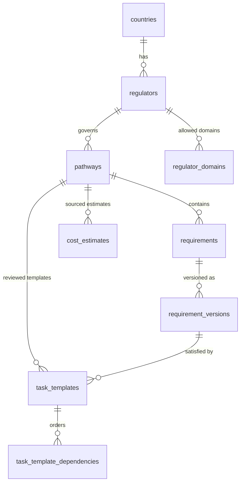
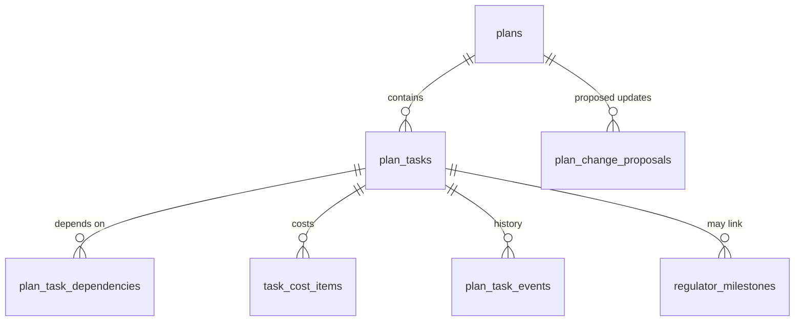

# Data model

Schemas and content models for Migration Hub on Supabase PostgreSQL. This is the design contract. Migrations in `supabase/migrations/` implement it. Related: [architecture.md](architecture.md), [requirements.md](requirements.md), [database.md](database.md), [security.md](security.md).

## 0. Principles

1. **Two ownership domains, never mixed.** _Regulatory content_ is owned by the platform and is read-only to users. _User data_ is owned by the user and is private. They connect only by foreign key, and user rows never copy or edit regulatory text.
2. **Versioned, append-only regulatory content.** A requirement has a stable identity and immutable versions. Published versions never change. Updates create a new version.
3. **Provenance on everything.** Every requirement carries source URL and dates. Every amount carries a currency and a provenance.
4. **User-reported is not regulator-confirmed.** Task progress that a user records is stored and labelled separately from milestones confirmed by a regulator.
5. **Unknown stays unknown.** Missing profile data is `NULL` or an `unknown` enum value, never a guess.
6. **Default deny.** RLS is enabled on every table. Policies are listed in section 6.

Conventions: `uuid` primary keys (`gen_random_uuid()`), `timestamptz` for instants, `date` for calendar dates, `created_at`/`updated_at` on mutable tables, snake_case, ISO 4217 currency codes, ISO 3166-1 alpha-2 country codes.

---

## 1. Regulatory content (platform-owned, read-only to users)

### 1.1 Entity overview



### 1.2 Reference tables

```sql
create table countries (
  code        char(2) primary key,            -- 'GB', 'IE'
  name        text not null
);

create table regulators (
  id          uuid primary key default gen_random_uuid(),
  country     char(2) not null references countries(code),
  name        text not null,                  -- 'General Medical Council'
  short_name  text not null,                  -- 'GMC'
  unique (country, short_name)
);

-- Allow-list: a source URL must be on one of its regulator's domains.
create table regulator_domains (
  regulator_id uuid not null references regulators(id),
  domain       text not null,                 -- 'gmc-uk.org'
  primary key (regulator_id, domain)
);

create table pathways (
  id           uuid primary key default gen_random_uuid(),
  country      char(2) not null references countries(code),
  regulator_id uuid not null references regulators(id),
  slug         text not null unique,
  name         text not null,
  is_active    boolean not null default true
);
```

### 1.3 Requirement (stable identity) and versions (immutable content)

`requirements` holds identity only. All descriptive content lives in `requirement_versions`.

```sql
create type requirement_obligation as enum ('mandatory', 'conditional');
create type version_status as enum
  ('draft', 'in_review', 'published', 'superseded', 'withdrawn');

create table requirements (
  id          uuid primary key default gen_random_uuid(),   -- Requirement ID (stable across versions)
  pathway_id  uuid not null references pathways(id),
  key         text not null,                                -- stable human key, e.g. 'gb-gmc-english-language'
  created_at  timestamptz not null default now(),
  unique (pathway_id, key)
);

create table requirement_versions (
  id                 uuid primary key default gen_random_uuid(),
  requirement_id     uuid not null references requirements(id),
  version            int  not null,                         -- 1, 2, 3 ...
  status             version_status not null default 'draft',

  -- Denormalised for traceability. Must match the parent requirement's pathway.
  country            char(2) not null references countries(code),
  regulator_id       uuid not null references regulators(id),
  pathway_id         uuid not null references pathways(id),

  title              text not null,
  explanation        text not null,                         -- plain language
  obligation         requirement_obligation not null,       -- Mandatory / Conditional
  condition_text     text,                                  -- required if conditional
  rule_definition    jsonb,                                 -- deterministic screening rule (versioned)
  rule_schema_version int,

  source_url         text not null,                         -- official regulator source
  access_date        date not null,                         -- date a reviewer accessed the source
  effective_date     date,                                  -- when the rule takes effect (null = in force)
  verified_date      date,                                  -- date a human verified it
  review_due_date    date,                                  -- next scheduled re-verification

  change_summary     text,                                  -- what changed vs previous version
  authored_by        uuid references auth.users(id),
  reviewed_by        uuid references auth.users(id),
  published_at       timestamptz,
  created_at         timestamptz not null default now(),

  unique (requirement_id, version),

  constraint conditional_needs_condition
    check (obligation = 'mandatory' or condition_text is not null),
  constraint source_is_https
    check (source_url ~* '^https://'),
  constraint published_is_complete
    check (status not in ('published', 'superseded')
           or (verified_date is not null
               and review_due_date is not null
               and review_due_date > verified_date
               and reviewed_by is not null
               and published_at is not null)),
  constraint reviewer_is_not_author
    check (reviewed_by is null or reviewed_by <> authored_by)
);

-- At most one published version per requirement.
create unique index one_published_version
  on requirement_versions (requirement_id) where status = 'published';
```

**Field mapping (required metadata):**

| Required field        | Column                                 | Notes                                                   |
| --------------------- | -------------------------------------- | ------------------------------------------------------- |
| Requirement ID        | `requirements.id` (+ `key`, `version`) | ID is stable, `(id, version)` identifies the exact text |
| Country               | `requirement_versions.country`         | ISO code                                                |
| Regulator             | `regulator_id`                         | FK to `regulators`                                      |
| Pathway               | `pathway_id`                           | FK to `pathways`                                        |
| Title                 | `title`                                |                                                         |
| Explanation           | `explanation`                          | Plain language, not legal advice                        |
| Mandatory/Conditional | `obligation` (+ `condition_text`)      | Conditional requires a stated condition                 |
| Official Source URL   | `source_url`                           | HTTPS and on the regulator's domain allow-list          |
| Access Date           | `access_date`                          | When the reviewer retrieved the source                  |
| Effective Date        | `effective_date`                       |                                                         |
| Verified Date         | `verified_date`                        | Required to publish                                     |
| Review Due Date       | `review_due_date`                      | Required to publish, after verified date                |

**Immutability rules (enforced in the database, not only in app code):**

1. A `BEFORE UPDATE` trigger rejects any change to content columns (everything except `status` transitions and `review` fields) when the row's `status` is `published`, `superseded` or `withdrawn`. Allowed transitions: `draft → in_review → published → superseded | withdrawn`. `draft` may return from `in_review`.
2. `DELETE` on `requirement_versions` for any non-draft row is rejected by trigger. Withdrawal is a status change, never a delete.
3. `requirement_versions.country/regulator_id/pathway_id` are checked by trigger against the parent requirement and pathway.
4. `source_url`'s host must match a `regulator_domains` row for the regulator (checked by trigger on transition to `in_review`/`published`).
5. Publishing requires `reviewed_by` to hold the `reviewer` or `admin` role and differ from `authored_by` (four-eyes). Publishing a new version atomically sets the previous published version to `superseded`.
6. Every status transition writes an `audit_events` row (section 5).

**Significant vs minor change:** any change to `obligation`, `rule_definition`, `title`, `explanation` meaning, `effective_date` or `source_url` is a new version. Re-verification with no change creates **no new version**. It records a `requirement_verifications` row and the published version's `verified_date`/`review_due_date` are advanced by a controlled function (the only permitted post-publication update, see below).

```sql
-- Re-verification without content change. Append-only history.
create table requirement_verifications (
  id                      uuid primary key default gen_random_uuid(),
  requirement_version_id  uuid not null references requirement_versions(id),
  verified_date           date not null,
  review_due_date         date not null check (review_due_date > verified_date),
  verified_by             uuid not null references auth.users(id),
  note                    text,
  created_at              timestamptz not null default now()
);
```

`requirement_versions.verified_date` and `review_due_date` of a published row are exposed through a view `current_requirements` that takes the latest `requirement_verifications` row (falling back to the version's own dates), so the published row itself stays untouched.

**Derived content status (never stored by clients):**

| Condition                                                              | Label shown            |
| ---------------------------------------------------------------------- | ---------------------- |
| Published and `review_due_date >= today` and not flagged               | Verified               |
| Published and (`review_due_date < today` or flagged `possible_change`) | Being checked          |
| Not published                                                          | Not shown to end users |

`possible_change` flags live in `requirement_flags` (admin or monitor created, append-only) and clear on re-verification.

### 1.4 Reviewed task templates and sourced costs

```sql
create type task_category as enum
  ('eligibility','documents','exams','application','verification','fees','travel','other');
create type task_priority as enum ('low','medium','high');

create table task_templates (
  id            uuid primary key default gen_random_uuid(),
  pathway_id    uuid not null references pathways(id),
  version       int not null,
  status        version_status not null default 'draft',
  title         text not null,
  description   text not null,
  category      task_category not null,
  priority      task_priority not null default 'medium',
  sort_order    int not null,
  requirement_id uuid references requirements(id),          -- satisfied requirement (identity)
  unique (pathway_id, version, sort_order)
);

create table task_template_dependencies (
  template_id            uuid not null references task_templates(id),
  depends_on_template_id uuid not null references task_templates(id),
  primary key (template_id, depends_on_template_id),
  check (template_id <> depends_on_template_id)
);
-- A trigger rejects inserts that would create a cycle (recursive CTE reachability check).

create type amount_provenance as enum ('regulator_published', 'platform_estimate', 'user_entered');

create table cost_estimates (                              -- platform-owned, source-backed
  id            uuid primary key default gen_random_uuid(),
  pathway_id    uuid not null references pathways(id),
  template_id   uuid references task_templates(id),
  label         text not null,
  amount_minor  bigint not null check (amount_minor >= 0), -- minor units, no floats
  currency      char(3) not null,
  provenance    amount_provenance not null check (provenance <> 'user_entered'),
  source_url    text not null,
  access_date   date not null,
  verified_date date not null,
  status        version_status not null default 'draft'
);
```

Task templates are versioned and immutable once published, with the same immutability triggers as requirement versions.

---

## 2. User profile (user-owned, private)

```sql
create type internship_status as enum
  ('not_started','in_progress','completed','not_applicable','unknown');
create type language_test_status as enum
  ('unknown','not_required','not_started','booked','passed','expired','exempt');
create type timeline_window as enum
  ('within_6_months','6_12_months','1_2_years','exploring','unknown');

create table profiles (
  user_id                 uuid primary key references auth.users(id) on delete cascade,
  preferred_name          text,
  residence_country       char(2) references countries(code),   -- current country of residence
  medical_school          text,
  medical_school_country  char(2) references countries(code),
  graduation_year         int check (graduation_year between 1950 and extract(year from now())::int + 8),
  internship_status       internship_status not null default 'unknown',
  internship_completed_on date,
  clinical_experience_years numeric(4,1) check (clinical_experience_years >= 0),
  specialty               text,                                  -- null = not sure yet
  language_test_status    language_test_status not null default 'unknown',
  language_test_type      text,                                  -- e.g. 'IELTS', 'OET' (optional)
  language_test_valid_until date,
  timeline                timeline_window not null default 'unknown',
  onboarding_step         smallint not null default 1,           -- save-and-resume
  onboarding_completed_at timestamptz,
  consent_version         text,                                  -- version of consent shown
  consented_at            timestamptz,
  created_at              timestamptz not null default now(),
  updated_at              timestamptz not null default now()
);

create table clinical_experience_entries (                       -- optional detail
  id          uuid primary key default gen_random_uuid(),
  user_id     uuid not null references auth.users(id) on delete cascade,
  role_title  text not null,
  country     char(2) references countries(code),
  started_on  date,
  ended_on    date check (ended_on is null or started_on is null or ended_on >= started_on)
);

create table destination_goals (
  id           uuid primary key default gen_random_uuid(),
  user_id      uuid not null references auth.users(id) on delete cascade,
  country      char(2) not null references countries(code),
  pathway_id   uuid references pathways(id),                     -- null = country interest only
  priority     smallint not null default 1,
  unique (user_id, country, pathway_id)
);
```

Rules:

- Every nullable field means **unknown**, and screening treats it as `unknown`, never as a default.
- `user_id` is **never** accepted from the client. It is read from the session on the server, and RLS also pins it to `auth.uid()`.
- Excluded by design: identity-document numbers, passport data, uploaded documents (no uploads in V1).
- On account deletion all rows cascade-delete. `audit_events` retains only a pseudonymous actor reference (see section 5).

### Screening results (user-owned, derived)

```sql
create type criterion_result as enum ('met','not_met','unknown');
create type pathway_outcome as enum
  ('potential_match','more_information_needed','potential_blocker');

create table screening_runs (
  id               uuid primary key default gen_random_uuid(),
  user_id          uuid not null references auth.users(id) on delete cascade,
  pathway_id       uuid not null references pathways(id),
  outcome          pathway_outcome not null,
  profile_snapshot jsonb not null,                       -- inputs used, for reproducibility
  engine_version   text not null,
  created_at       timestamptz not null default now()
);

create table screening_criterion_results (
  run_id                 uuid not null references screening_runs(id) on delete cascade,
  requirement_version_id uuid not null references requirement_versions(id),
  result                 criterion_result not null,
  missing_fields         text[] not null default '{}',   -- what would resolve 'unknown'
  primary key (run_id, requirement_version_id)
);
```

Runs are append-only and written by the server screening service. Users cannot insert or edit results directly.

### Match runs and results (Review pathway matches flow)

```sql
create table match_runs (
  id                  uuid primary key default gen_random_uuid(),
  user_id             uuid not null references auth.users(id) on delete cascade,
  profile_snapshot    jsonb not null,
  profile_hash        text not null,
  engine_version      text not null,
  content_fingerprint text not null,
  created_at          timestamptz not null default now()
);

create table match_results (
  id                  uuid primary key default gen_random_uuid(),
  run_id              uuid not null references match_runs(id) on delete cascade,
  pathway_id          uuid not null references pathways(id) on delete cascade,
  pathway_version_id  uuid not null references pathway_versions(id) on delete cascade,
  status              text not null check (status in ('requirement_unmet','potential_blocker','more_info_needed','potential_match')),
  criteria            jsonb not null,
  missing             jsonb not null default '[]'::jsonb,
  sort_rank           int not null,
  created_at          timestamptz not null default now()
);
```

`save_match_run(...)` is an atomic, security-definer function enforcing user profile ownership, cooldown between checks, and returning existing runs when profile hash and content fingerprint are unchanged.

---

## 3. Plan and tasks

### 3.1 Entities



### 3.2 Schema

```sql
create type plan_task_status as enum
  ('not_started','in_progress','waiting','blocked','completed');

create table plans (
  id                  uuid primary key default gen_random_uuid(),
  user_id             uuid not null references auth.users(id) on delete cascade,
  pathway_id          uuid not null references pathways(id),
  based_on_content_at timestamptz not null,              -- content version basis
  created_at          timestamptz not null default now(),
  archived_at         timestamptz,
  unique (user_id, pathway_id) -- one active plan per pathway; relax with partial index if needed
);

create table plan_tasks (
  id                uuid primary key default gen_random_uuid(),    -- Task ID
  plan_id           uuid not null references plans(id) on delete cascade,
  user_id           uuid not null references auth.users(id) on delete cascade, -- must equal plans.user_id
  pathway_id        uuid not null references pathways(id),          -- associated pathway (matches plan)
  template_id       uuid references task_templates(id),             -- null = user-added task
  template_version  int,
  source            text not null check (source in ('template','user')),
  title             text not null,                                  -- copied snapshot, user may rename
  notes             text,
  category          task_category not null,
  priority          task_priority not null default 'medium',
  status            plan_task_status not null default 'not_started',
  sort_order        int not null,
  due_date          date,
  -- User-reported progress. Always attributed to the user.
  status_set_by     text not null default 'user' check (status_set_by = 'user'),
  status_updated_at timestamptz not null default now(),
  completed_at      timestamptz,
  -- Changed-requirement flag. Informational, never alters status.
  requirement_changed_at timestamptz,
  requirement_change_acknowledged_at timestamptz,
  created_at        timestamptz not null default now(),
  constraint completed_has_timestamp
    check ((status = 'completed') = (completed_at is not null))
);

create table plan_task_dependencies (
  task_id            uuid not null references plan_tasks(id) on delete cascade,
  depends_on_task_id uuid not null references plan_tasks(id) on delete cascade,
  primary key (task_id, depends_on_task_id),
  check (task_id <> depends_on_task_id)
);
-- Trigger: both tasks must belong to the same plan; reject cycles.

create table task_cost_items (
  id            uuid primary key default gen_random_uuid(),
  task_id       uuid not null references plan_tasks(id) on delete cascade,
  user_id       uuid not null references auth.users(id) on delete cascade,
  label         text not null,
  amount_minor  bigint not null check (amount_minor >= 0),
  currency      char(3) not null,
  provenance    amount_provenance not null,
  cost_estimate_id uuid references cost_estimates(id),       -- required when provenance <> 'user_entered'
  constraint estimate_ref_consistent
    check ((provenance = 'user_entered') = (cost_estimate_id is null))
);

create table plan_task_events (                              -- append-only activity log
  id          uuid primary key default gen_random_uuid(),
  task_id     uuid not null references plan_tasks(id) on delete cascade,
  user_id     uuid not null references auth.users(id) on delete cascade,
  event_type  text not null,       -- 'status_changed','due_date_changed','change_flagged','change_acknowledged'
  from_value  text,
  to_value    text,
  created_at  timestamptz not null default now()
);

create table plan_change_proposals (                         -- proposed plan changes, user-reviewed
  id           uuid primary key default gen_random_uuid(),
  plan_id      uuid not null references plans(id) on delete cascade,
  user_id      uuid not null references auth.users(id) on delete cascade,
  kind         text not null check (kind in ('add_task','remove_task','reorder','change_dependency','update_task')),
  payload      jsonb not null,
  cause_version_id uuid references requirement_versions(id),
  state        text not null default 'pending' check (state in ('pending','accepted','declined')),
  decided_at   timestamptz,
  created_at   timestamptz not null default now()
);
```

**Field mapping (required):** Task ID `plan_tasks.id`; associated pathway `pathway_id`; category `category`; priority `priority`; status `status` (`not_started`, `in_progress`, `waiting`, `blocked`, `completed`, shown as Not started, In progress, Waiting, Blocked, Completed); due date `due_date`; dependencies `plan_task_dependencies`; estimated costs `task_cost_items`.

**Behaviour rules:**

- **Blocked** is a _user-selectable_ state ("I am blocked") **and** a derived hint: a task whose dependencies are not completed displays "Waiting for: <task>" without changing stored status. The two are not conflated.
- A content update **never** writes to `plan_tasks.status` or `completed_at`. It sets only `requirement_changed_at`, and the user acknowledges or reopens. (Requirement PL-10.)
- `status_set_by` is constrained to `'user'`. The system cannot complete a task on a user's behalf.
- Cost items separate provenance: sourced estimates (`regulator_published`, `platform_estimate`) reference `cost_estimates`, while user-entered amounts do not. Every amount has an explicit currency and is shown with its provenance. Amounts in different currencies are never summed without an explicit, displayed conversion.
- Dependency graphs are acyclic, enforced by trigger on insert/update.

---

## 4. User-reported progress vs regulator-confirmed milestones

These are separate tables with different writers and different labels.

|                 | User-reported progress                  | Regulator-confirmed milestone                                                                          |
| --------------- | --------------------------------------- | ------------------------------------------------------------------------------------------------------ |
| Table           | `plan_tasks.status`, `plan_task_events` | `regulator_milestones`                                                                                 |
| Meaning         | "I did / am doing this"                 | "The regulator confirmed this happened"                                                                |
| Writer          | The owning user (via server service)    | Platform process only (service role, with evidence). **Never** the user                                |
| UI label        | "Marked done by you"                    | "Confirmed by <regulator> on <date>"                                                                   |
| Effect on tasks | Drives plan progress                    | None automatically. Linked for display only                                                            |
| V1 status       | In use                                  | Schema reserved. No regulator integration exists, so **nothing is labelled regulator-confirmed in V1** |

```sql
create type milestone_confirmation_source as enum
  ('regulator_api', 'regulator_correspondence_verified_by_staff');

create table regulator_milestones (
  id               uuid primary key default gen_random_uuid(),
  user_id          uuid not null references auth.users(id) on delete cascade,
  plan_task_id     uuid references plan_tasks(id) on delete set null,
  regulator_id     uuid not null references regulators(id),
  milestone_key    text not null,               -- e.g. 'registration_granted'
  confirmed_on     date not null,
  confirmation_source milestone_confirmation_source not null,
  evidence_ref     text not null,               -- reference only; no document is stored in V1
  recorded_by      uuid references auth.users(id),  -- staff actor, null for API
  created_at       timestamptz not null default now()
);
```

Integrity rules:

1. Users have **no** insert/update/delete privilege on `regulator_milestones` (SELECT own rows only). Writes go through the service-role client inside an audited admin service.
2. A user marking a task done never creates or implies a milestone. A milestone never auto-completes a task. The UI may suggest "Regulator confirmed this. Mark the task done?", and the user decides.
3. The UI label is derived from the table of origin, so user-reported progress cannot be rendered with confirmed styling.
4. Milestones are append-only. Corrections are new rows with a corrective note, never edits.

---

## 5. Administration and audit

```sql
create type app_role as enum ('user', 'reviewer', 'admin');

create table user_roles (
  user_id  uuid not null references auth.users(id) on delete cascade,
  role     app_role not null,
  primary key (user_id, role)
);
-- No client write access. Roles are granted by admins via the service role.

create table audit_events (                                   -- append-only
  id          bigint generated always as identity primary key,
  actor_id    uuid,                                           -- nullable, pseudonymised on account deletion
  action      text not null,         -- 'requirement_version.published', 'milestone.recorded', ...
  entity_type text not null,
  entity_id   uuid not null,
  detail      jsonb not null default '{}',                   -- no personal profile data
  created_at  timestamptz not null default now()
);
```

`audit_events` rejects UPDATE and DELETE by trigger, and stores no sensitive profile content. Retention period is documented in [security.md](security.md).

---

## 6. Ownership and Row Level Security matrix

RLS is enabled on every table. "Own" means `user_id = auth.uid()`. The service role bypasses RLS and is used only in audited server services after an explicit role check.

| Table(s)                                                                                                        | anon | authenticated user                                      | reviewer                                                | admin / service          |
| --------------------------------------------------------------------------------------------------------------- | ---- | ------------------------------------------------------- | ------------------------------------------------------- | ------------------------ |
| `countries`, `regulators`, `regulator_domains`, `pathways`                                                      | read | read                                                    | read                                                    | write                    |
| `requirements`, `requirement_versions`                                                                          | none | **read published/superseded only**                      | read all, write drafts, transition (not own authorship) | write, publish           |
| `requirement_verifications`, `requirement_flags`                                                                | none | none (surfaced via `current_requirements` view)         | write                                                   | write                    |
| `task_templates`, `task_template_dependencies`, `cost_estimates`                                                | none | read published                                          | write drafts                                            | write, publish           |
| `profiles`, `clinical_experience_entries`, `destination_goals`                                                  | none | **own: select, insert, update, delete**                 | none                                                    | none (no routine access) |
| `screening_runs`, `screening_criterion_results`                                                                 | none | own: select only                                        | none                                                    | server-written           |
| `plans`, `plan_tasks`, `plan_task_dependencies`, `task_cost_items`, `plan_task_events`, `plan_change_proposals` | none | own: select, insert, update, delete (see column limits) | none                                                    | none                     |
| `regulator_milestones`                                                                                          | none | **own: select only**                                    | none                                                    | server-written only      |
| `user_roles`, `audit_events`                                                                                    | none | none                                                    | audit read                                              | write via service        |

Specific policies:

- Published-only read: `using (status in ('published','superseded'))` on requirement and template tables for non-reviewers. Drafts and in-review rows are never visible to users.
- No `UPDATE` or `DELETE` policy exists for any role on published `requirement_versions`, even for admins through the client. Changes go through database functions that enforce the transitions.
- Owner write policies use `with check (user_id = auth.uid())`, and, for child tables, check the parent's owner, for example `exists (select 1 from plans p where p.id = plan_id and p.user_id = auth.uid())`.
- Column-level restrictions: users cannot modify `plan_tasks.template_id`, `pathway_id`, `requirement_changed_at` or `status_set_by` (enforced by a trigger or by routing updates through a function).
- `plan_task_events`, `screening_*` and `audit_events` are append-only.
- Use `security definer` functions sparingly, with `search_path` pinned, and only for the controlled transitions above.

### Integrity rules summary

1. Regulatory requirements are **read-only** to every end user, with no write path from client credentials.
2. A published requirement version is **immutable**, and changes create a new version. Re-verification is append-only.
3. Publishing needs source URL on the regulator's allow-list, verified and review-due dates, and a second reviewer.
4. A requirement without a status, verified date or source cannot be published, so it cannot be rendered.
5. Users own only their rows, and ownership comes from the session, never a client-supplied ID.
6. User-reported progress and regulator-confirmed milestones live in different tables with different writers and labels.
7. Content updates never modify user task status or completion.
8. Every amount carries currency and provenance, and sourced estimates are separate from user-entered figures.
9. Dependency graphs are acyclic and within one plan.
10. Account deletion cascades through all user-owned rows. Audit events are pseudonymised, not retained with identity.

## 7. Offline mirror and local drafts

The client IndexedDB mirror (see [architecture.md](architecture.md)) stores _copies_ only: the user's plan, tasks, and the `current_requirements` snapshot with `verified_date`, `review_due_date`, `source_url` and version. Mirrored regulatory data is read-only locally and replaced on sync. Local edits apply only to user-owned entities and sync through the server. Drafts exclude any field not in `profiles` or `plan_tasks` and contain no secrets.

## 8. Type generation and validation

- Generate TypeScript types with `supabase gen types typescript` into `src/types/`.
- Zod schemas in each `features/*` module mirror these constraints at the input boundary (profile steps, task updates). The database constraints remain the final guard.
- Rule definitions (`rule_definition`) are validated against a Zod schema keyed by `rule_schema_version` before a version can enter review.

## 9. Open decisions

- Final per-requirement-type freshness windows (for example 90 days for fees, 180 days for general requirements).
- Whether to allow multiple concurrent plans for one pathway (currently one).
- Whether a regulator ever provides an API or verifiable confirmation channel. Until then `regulator_milestones` stays empty.
- Whether `specialty` is a controlled vocabulary table or free text with suggestions (currently text).
